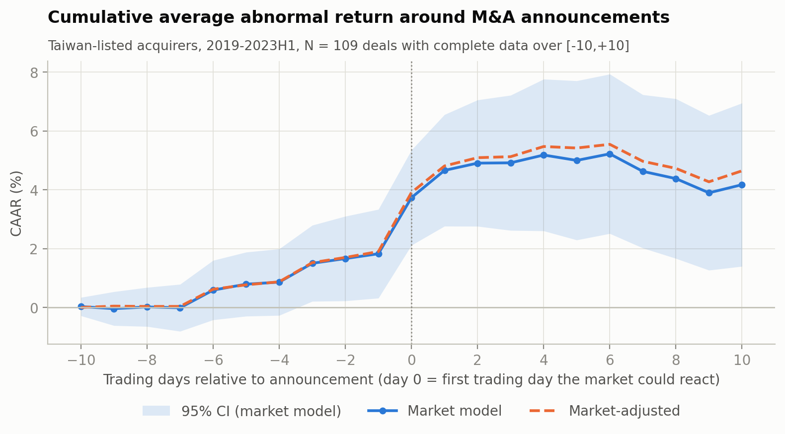
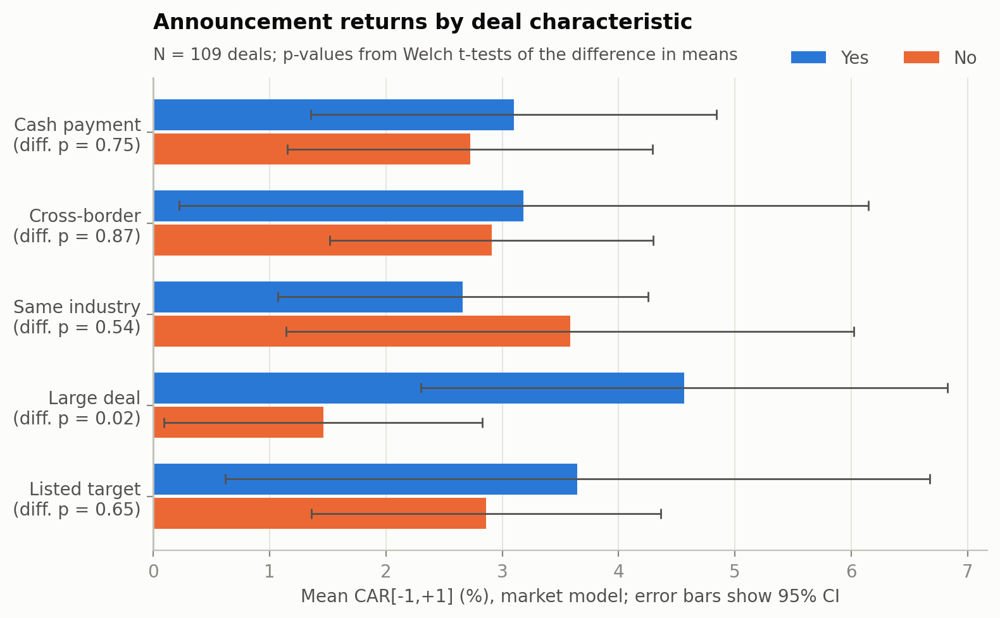
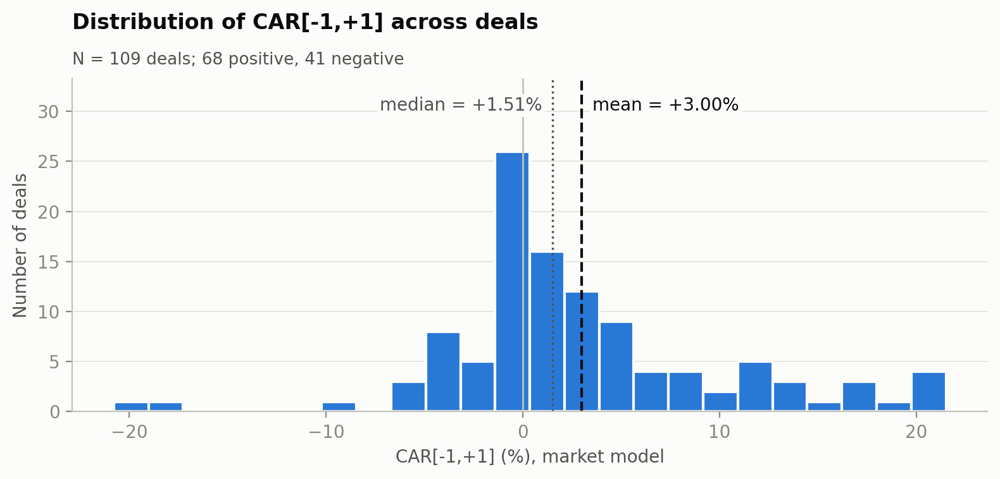

# How does Taiwan's stock market react when a listed company announces an acquisition?

**An event study of 109 control acquisitions by Taiwan-listed companies, January 2019 – June 2023**

Vivian (Chih-Jung) Wei · MBA, National Taipei University · October 2026

📄 **One-page summary:** [`summary/Taiwan_MA_Announcement_Returns_OnePage.pdf`](summary/Taiwan_MA_Announcement_Returns_OnePage.pdf)

---

## The answer in three lines

1. **Acquirers gain on announcement.** Over the three trading days around the announcement, the acquirer's share price beat its expected return by **+3.00% on average** (95% CI 1.64% to 4.36%; median +1.51%; 68 of 109 rose). The result holds under four statistical tests, eight window-and-model combinations and eight sample cuts.
2. **Larger deals relative to the buyer gain more.** Holding other deal features constant, a deal twice as large relative to the acquirer's market value goes with a return **1.26 percentage points higher** (p = 0.027). The direction is positive in all 10 regression specifications and significant at 5% in 8; it keeps its size but loses significance once 26 related-party deals are removed. Consistent but moderate evidence.
3. **Payment method, geography and industry overlap show no detectable difference.** Cash vs. stock, domestic vs. cross-border and same-industry vs. not all differ by less than 1 percentage point (p = 0.54 to 0.87).

---

## Why this question

An acquisition is one of the largest and least reversible decisions a company makes. The share-price reaction on announcement day is the market's first verdict on that decision. Taiwanese deals have their own features: in this sample, 90 of the 109 targets are unlisted companies and 26 deals involve related parties. Taiwan also has no ready-made M&A database, so the sample had to be built from exchange filings.

## How the sample was built

There is no M&A deal list for Taiwan in TEJ, so every deal was identified from the Market Observation Post System (MOPS) material-information filings, downloaded from TEJ.

| Step | Count |
|---|---|
| MOPS material-information filings, Jan 2018 – Jun 2023 (including weekends and holidays) | 378,883 |
| Candidate filings selected by filing form (merger, share exchange, tender offer, securities acquisition) and keywords | 2,639 |
| Grouped into deals (multiple filings about one deal → one deal, dated by its first announcement) | 1,425 |
| First announced in 2019 or later, with enough price history | 1,035 |
| Deals with at least one standard-form filing, flagged A/B by the screening rules → **reviewed one by one** | 250 |
| Machine-excluded deals (C) checked by hand as a quality control | random 60 of 618 |
| **Final sample after review** | **109 deals, 99 acquirers** |

Each of the 250 candidates was classified with an AI-assisted first pass and then verified against the original filing text. A deal was kept only if all of the following held:

- the listed company is the **buyer** and was listed on TWSE or TPEx (not the emerging board) on the announcement date;
- it is the **first announcement** of the deal;
- the buyer **gains control** (stake goes from ≤ 50% to > 50%) of an operating company or business unit;
- the deal value is **at least 1%** of the buyer's market value at the end of the month before the announcement;
- the buyer is **not a financial company**.

Why the 250 candidates were excluded:

| Reason | Deals |
|---|---|
| Intra-group (buyer already controlled the target, or bought it from its parent or a sister company) | 51 |
| Minority stake (buyer still holds ≤ 50% afterwards) | 32 |
| Deal smaller than 1% of buyer's market value | 16 |
| Other (transfer for no consideration, filing made after the fact, value or stake not disclosed) | 16 |
| Asset purchase (land and buildings, not a business) | 9 |
| Emerging-board company at announcement | 7 |
| Company was the target, not the buyer | 5 |
| Second deal by the same company within 60 trading days | 3 |
| Not the first announcement | 2 |

Data-quality issues found and fixed along the way:

- **Weekend filings missing.** The first download covered trading days only; a day-of-week check showed no Sunday filings at all. Re-downloading recovered 9,142 filings (about 2.5%).
- **One deal split into several.** Repeated filings about the same deal (e.g., GlobalWafers / Siltronic appeared as three deals) were merged, and the first announcement date was traced back to the earliest filing.
- **Emerging-board stocks look "listed".** TEJ's price data includes emerging-board stocks, so having a share price does not mean being listed; these were identified from the filing's clause number and excluded.

## How the returns were measured

- **Event day (day 0)** = the first trading day on which the market could react. Filings after the 13:30 close move to the next trading day (102 of 109 deals were announced after the close).
- **Normal return** comes from a market model estimated over trading days −150 to −31 (at least 100 valid days), against TEJ's total-return market index. **Abnormal return** = actual return − normal return.
- **Main measure:** cumulative abnormal return over days −1 to +1, CAR[−1,+1].
- **Tests:** t-test, Boehmer–Musumeci–Poulsen standardized test, generalized sign test, Wilcoxon signed-rank test.
- **Cross-section:** OLS of CAR[−1,+1] on cash payment, cross-border, same industry, ln(relative size) and ln(acquirer market value), with heteroskedasticity-robust (HC1) standard errors.
- **Pre-specified:** the main window, the groupings and the regression specification were fixed before results were seen.

**Trading halts.** Taiwanese companies often halt trading on the day the board approves a deal (26 of the 109 deals have a no-trade day in [−1, +1]). A no-trade day is excluded from the estimation window (it is not a genuine 0% return) but counted as a 0% return inside the event window, so the reaction on the day trading resumes is captured in the cumulative total. Dropping these deals instead would remove 26 of the most formal deals from the sample. Two deals announced during trading hours on a full-day halt have day 0 moved to the first day with trading.

## How robust is the main result?

Mean CAR (%), market model unless noted; all 16 rows below are significant at the 1% level under the t-test.

| Event window | Market model | Market-adjusted |
|---|---|---|
| [−1, +1] (main) | **3.00** | 3.11 |
| [0, +1] | 2.83 | 2.91 |
| [−5, +5] | 4.41 | 4.80 |
| [−10, +10] | 4.18 | 4.65 |

| Sample, CAR[−1,+1] | N | Mean (%) |
|---|---|---|
| Full sample | 109 | 3.00 |
| Excluding related-party deals | 83 | 2.88 |
| Excluding KY (offshore-registered) companies | 98 | 3.06 |
| Excluding borderline cases flagged in review | 99 | 2.87 |
| Excluding the COVID crash (20 Jan – 30 Apr 2020) | 104 | 3.20 |
| Excluding deals with a no-trade day in [−1, +1] | 83 | 3.13 |
| Cash deals only | 80 | 3.10 |
| Stock or mixed deals only | 29 | 2.72 |

The mean is about twice the median because a few deals rose sharply; the rank-based and sign tests, which are not driven by extreme values, are also significant (p ≤ 0.001). Full tables are in [`results/results_tables.xlsx`](results/results_tables.xlsx).

## What this study cannot tell you

- Announcement returns measure **what the market expects**, not how the deal performs afterwards.
- Prices had already risen 1.8% over the ten days before the announcement, so the three-day window may understate the full reaction. This is a pattern, not a tested finding.
- Relative size is chosen by the acquirer: the size result is an **association, not causation**.
- The five deal characteristics explain only about 3% of the variation between deals (adjusted R² 0.033; overall F-test p = 0.14). Most of what drives an individual deal's reaction is not captured here.
- With 109 deals (29 paid in stock, 19 with listed targets), small differences between groups cannot be detected. "No detectable difference" does not mean "no effect".
- Coverage ends in June 2023 because the filing database ends there; deals announced only in free-form filings, without a standard deal form, are not included.

## Repository contents

| Path | What it is |
|---|---|
| `notebooks/01_screen_candidates.ipynb` | Screens the 378,883 filings, groups filings into deals, flags exclusion reasons, builds the review sheet |
| `notebooks/02_finalize_sample.ipynb` | Checks the completed review, converts foreign-currency amounts, computes relative size, outputs the event list |
| `notebooks/03_event_study.ipynb` | Market model, abnormal returns, tests, subgroup comparisons, regressions, robustness checks, figures |
| `data/events_public.csv` | The 109 deals: announcement date and timing, target, payment, cross-border, industry relation, flags |
| `results/results_tables.xlsx` | All summary tables: tests by window and sample, daily abnormal returns, subgroups, regressions |
| `figures/` | The three figures above |
| `summary/` | One-page summary for decision-makers |

The notebooks are run in Google Colab and their commentary is written in Chinese. They are shared without outputs.

**Data.** Share prices, returns, market values and the filing text come from the TEJ database under a university licence and are not redistributed here, so the notebooks cannot be re-run from this repository alone. `events_public.csv` contains only information disclosed in public filings. An asterisk after a firm name is carried over from the company's short name in the source database.

`events_public.csv` columns: `event_id`, `stock_id`, `firm_name`, `announce_date`, `announce_timing` (盤後 after close / 盤中 intraday / 盤前 pre-open), `year`, `target_name`, `payment` (cash / stock / mixed), `cross_border` (1 = target operates outside Taiwan), `relatedness` (same_industry / vertical / unrelated), `target_listed`, `related_party`, `ky_firm`, and five `flag_*` columns marking borderline cases identified in review.

## How this project was done

The Python code was written with the help of an AI assistant (Claude). The research question, sample rules, review of every candidate deal against the original filings, decisions on borderline cases, and the interpretation of results are my own. Every number reported here comes from running the notebooks on the actual TEJ data.
